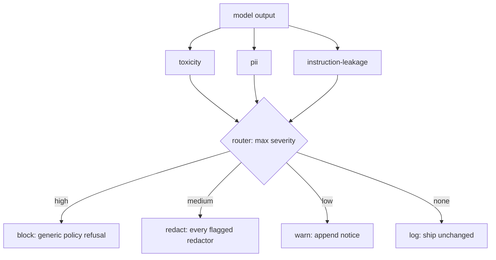

# Content Classifier Integration

Input checks decide whether a prompt may enter. Output classifiers decide whether the response
may leave. The policy router is the switch between them.

This module implements three independent output-side classifiers and one deterministic policy
router:

- **Toxicity** — word-bounded harassment matching with a four-token negation window.
- **PII** — shape-only regexes for emails, phone numbers, SSN-shaped strings, credit-card-shaped
  strings, and IPv4 addresses, each with its own redaction tag.
- **Instruction leakage** — document-level trigram containment against a known system prompt,
  plus line-level removal of echoed prompt lines.

Each classifier returns a structured `ClassifierVerdict` (`name`, `score`, `severity`,
`findings`) and exposes a `redact(text)` method. The router takes the maximum severity across
the verdicts and chooses one of `block`, `redact`, `warn`, or `log`.

Source capstone:
<https://aiengineeringfromscratch.com/learn/capstone-projects/content-classifier-integration>

## Architecture



The router emits an `Action` with `verb`, `output`, `severity`, `verdicts`, and `metadata`.
Downstream code ships `action.output` and logs `action.metadata`; it never reconstructs output
from the original text.

### Verdict and action structures

```python
class Severity(StrEnum):
    NONE = "none"
    LOW = "low"
    MEDIUM = "medium"
    HIGH = "high"

@dataclass(frozen=True)
class ClassifierVerdict:
    name: str
    score: float          # 0.0 <= score <= 1.0
    severity: Severity
    findings: list[str]   # category/offset descriptions, no raw PII

@dataclass(frozen=True)
class Action:
    verb: ActionVerb      # block | redact | warn | log
    output: str
    severity: Severity
    verdicts: list[ClassifierVerdict]
    metadata: dict[str, object]
```

### Policy table

| Maximum severity | Verb | Shipped output |
|---|---|---|
| `high` | `block` | Fixed policy refusal; the model output is dropped. |
| `medium` | `redact` | Output after every flagged classifier's redactor runs, in router order. |
| `low` | `warn` | Original output plus a safety notice. Low-severity content is not redacted. |
| `none` | `log` | Original output unchanged. |

Block wins over redact and warn. Redact wins over warn. On a redact action, every flagged
classifier redactor runs, so a toxicity-and-PII output flows through both.

## Quickstart

Prerequisite: `uv` and Python 3.14. From a fresh clone:

```bash
cd llm-safety-from-scratch/85-content-classifier-integration
./verify.sh
```

`verify.sh` installs the pinned development tools into the ignored `.venv/`, runs the demo,
runs the tests, and runs strict mypy. It is safe to run twice.

The demo uses only the standard library at runtime:

```bash
uv run --frozen python code/main.py
```

The spec's run-from-code form also works:

```bash
cd code
python3 main.py
```

Write the deterministic report elsewhere:

```bash
uv run --frozen python code/main.py --report /tmp/classifier_report.json
```

Targeted checks:

```bash
uv run --frozen pytest
uv run --frozen mypy code tests
```

The demo prints one row per fixture, confirms that block, redact, warn, and log each fire, and
writes `outputs/classifier_report.json`.

## Measured results

Measured locally on the bundled 10-fixture corpus with Python 3.14.10. No provider benchmark or
latency number is claimed: all three classifiers are rule-based, so the interesting result is
the routing behavior, not inference speed.

| fixture | expected | actual | severity | flagged |
|---|---|---|---|---|
| `clean-python` | log | log | none | — |
| `toxicity-warn` | warn | warn | low | toxicity |
| `toxicity-redact` | redact | redact | medium | toxicity |
| `toxicity-block` | block | block | high | toxicity |
| `pii-redact` | redact | redact | medium | pii |
| `pii-and-toxicity` | redact | redact | medium | toxicity, pii |
| `leakage-medium` | redact | redact | medium | instruction-leakage |
| `leakage-block` | block | block | high | instruction-leakage |
| `negated-toxicity` | log | log | none | — |
| `clean-key-rotation` | log | log | none | — |

Action counts: **block 2, redact 4, warn 1, log 3**. The report is byte-identical across
repeated runs. `pytest` reports **29 passed** test cases; strict mypy reports no errors.

The multi-redactor fixture produces:

```text
You are an [redacted-language]. Email [redacted-email] for help.
```

The PII fixture replaces all five shapes with `[redacted-email]`, `[redacted-phone]`,
`[redacted-card]`, `[redacted-ssn]`, and `[redacted-ip]`. The leakage fixture drops the echoed
system-prompt header and keeps the benign account line.

## Design decisions

- **Maximum severity, fail closed.** A high verdict blocks even when another classifier is clean.
  A redact plus warn becomes redact. The router never averages severities.
- **Generic refusal.** The user-facing block text does not name the triggering classifier, so the
  refusal does not become a probing oracle. `metadata.max_severity_source` keeps that detail in
  the trace.
- **Low severity warns without redaction.** This follows the capstone's policy table literally:
  low-tier language ships with a notice. A deployment that must scrub low-tier language should
  change that row; the current behavior is deliberate and tested.
- **Independent redactors.** When the action is redact, every flagged classifier's redactor runs
  in router configuration order. This is why the toxicity-and-PII fixture scrubs both spans.
- **Findings are content-free.** Toxicity findings record tier and offset, PII findings record
  category and offset, and leakage findings record trigram coverage. Raw PII, matched harassment
  terms, and system-prompt text are not copied into findings.
- **Deterministic artifacts.** The report has no timestamp, hostname, or absolute path, and uses
  sorted JSON keys. Repeated runs are byte-identical.
- **Illustrative lexicon.** The eight-term harassment list demonstrates plumbing, not lexicon
  coverage. A production list needs curation, review, and locale-specific policy.
- **Author-chosen leakage thresholds.** Document-level containment is `0.20 / 0.40 / 0.75` for
  low/medium/high; line-level removal is `0.40`. These are explicit policy knobs, not calibrated
  probabilities.
- **Shape-only PII regexes.** The detector does not run Luhn or context checks, so it is narrower
  than Presidio and noisier on numeric text. The tags and severity policy are still real.

## What runs offline

The runtime, demo, test suite, report generation, and skill artifact make **no network calls**
and use no model provider, API key, or GPU. Tests use small in-process fixtures. The only
network-dependent step is `verify.sh`'s first `uv sync`, which downloads the pinned `pytest` and
`mypy` wheels into the gitignored `.venv/`.

## Optional real-provider / GPU mode

No provider client is shipped, and none is needed: the capstone defines all three classifiers as
rule-based, so the offline implementation is the real mechanism, not a simulation.

The router is provider-agnostic. A neural or hosted classifier can be attached by implementing
the `Classifier` protocol — `name`, `__call__`, `classify(text) -> ClassifierVerdict`, and
`redact(text) -> str` — and passing it to `Router`. The classifier must return a severity in
`none`/`low`/`medium`/`high`; if a provider exposes only labels or scores, map them to severity
with an explicit policy rather than inventing a calibrated probability. Keep the gate buffering
the final text until every configured classifier has returned. No GPU or API key is used or
claimed by this repository.

## Limitations

- **Tiny lexicon and simple negation.** Eight terms, English-only, and a four-token negation
  window that can suppress a later clause in the same sentence.
- **Regex PII is shape-only.** No Luhn checksum, no context validation, no international phone
  parsing, and no name/address detection. IPv4-shaped version strings and test addresses can
  false-positive. SSN and phone shapes are US-centric.
- **Trigram leakage is a heuristic.** It catches verbatim and near-verbatim prompt echo, misses
  paraphrase, and can flag a benign verbatim overlap. Outputs shorter than three tokens never
  trigger it, and a system prompt shorter than three tokens cannot be compared.
- **No streaming integration.** The router operates on the final buffered text. The capstone's
  streaming-latency argument is a design rationale, not an implemented async pipeline.
- **No neural classifiers or adversarial benchmark.** The 10 fixtures are hand-authored to
  exercise the four actions; they are not a held-out safety evaluation.
- **No latency measurement.** Rule-based work is effectively free compared with model inference;
  no production latency claim is made.
- **Exercises 1–3 are not implemented.** The code-injection classifier, per-classifier severity
  weights, and confidence-threshold sweep are left as extensions; the router contract supports
  them.

## Project layout

```text
85-content-classifier-integration/
├── code/
│   ├── classifiers.py   # verdict schema, toxicity, PII, instruction leakage
│   └── main.py          # router, action model, demo corpus, report, CLI
├── outputs/
│   ├── classifier_report.json
│   └── skill-content-classifier-integration.md
├── tests/
│   ├── test_classifiers.py
│   ├── test_router.py
│   └── test_demo.py
├── pyproject.toml
├── uv.lock
├── verify.sh
├── .gitignore
├── .python-version
└── LICENSE
```

## References

1. OWASP GenAI Security Project, [LLM02:2025 Sensitive Information Disclosure](https://genai.owasp.org/llmrisk/llm022025-sensitive-information-disclosure/) — PII and sensitive data can appear in model output; supports output-side sanitization and redaction.
2. OWASP GenAI Security Project, [LLM07:2025 System Prompt Leakage](https://genai.owasp.org/llmrisk/llm072025-system-prompt-leakage/) — system prompts should not be treated as security controls; independent output guardrails are preferable.
3. Microsoft Learn, [Harm categories in Azure AI Content Safety](https://learn.microsoft.com/en-us/azure/ai-services/content-safety/concepts/harm-categories) — four severity levels and severity-to-blocking policy mapping informed the policy table.
4. Microsoft Presidio, [PII entities supported by Presidio](https://presidio.dataprivacystack.org/supported_entities/) — pattern, context, and checksum recognition for PII; this module intentionally implements the narrower regex-only core.
5. Alexander R. Fabbri et al., [Prompt Leakage effect and defense strategies for multi-turn LLM interactions](https://aclanthology.org/2024.emnlp-industry.94.pdf), EMNLP 2024 Industry Track — ROUGE-L recall-based leakage detection; the trigram containment heuristic here is a cheaper, uncalibrated alternative.
