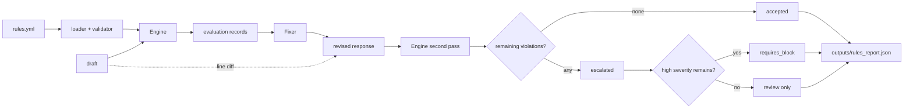

# Constitutional Rules Engine

## Overview

Classifiers cover recognizable failures. Rules cover contractual ones. This module implements a
declarative rules engine for response constraints that a content classifier cannot see: a refusal
must offer a next step, a code answer must close cleanly, cited claims need citations, internal
library names must never leak, and responses must stay within a word budget.

A constitution is a reviewed YAML file. Each rule has a `name`, `severity`, `explanation`, a scope
predicate (`applies_when`), a required predicate (`must`), and an optional local fix. The engine
evaluates every rule and records `pass`, `violation`, or `not_applicable`. The fixer produces a
revised response, the engine evaluates it a second time, and a structured line diff is written to
`outputs/rules_report.json` for audit.

Source capstone:
<https://aiengineeringfromscratch.com/learn/capstone-projects/constitutional-rules-engine>

## Architecture



The engine is generic: it knows the predicate grammar, not the six shipped rules. The constitution
lives beside the code, is reviewed like code, and can change without editing the engine.

### Rule shape

The constitution is a non-empty YAML list:

```yaml
- name: end-with-runnable-or-assumption
  severity: medium
  applies_when:
    contains_regex: '```python'
  must:
    any_of:
      - ends_with_regex: '```\s*$'
      - contains_regex: '(?i)\bassumption:'
  explanation: 'A code response must close with a fence or state an assumption.'
  fix:
    append_if_missing: "\n\nAssumption: example inputs are valid."
```

`applies_when` decides whether the rule is in scope. If it is omitted, the rule applies to every
response. If it is present and false, the record is `not_applicable` and `must` is not evaluated.
The `explanation` is stored and logged verbatim; it is not format-evaluated.

### Predicate grammar

| Predicate | Argument | Meaning |
|---|---|---|
| `contains_regex` | regex string | A match exists anywhere in the text. |
| `not_contains_regex` | regex string | No match exists anywhere. |
| `ends_with_regex` | regex string | A match ends exactly at the end of the text. |
| `starts_with_regex` | regex string | A match starts at offset zero. |
| `max_words` | non-negative integer | Whitespace-split words are at most the limit. |
| `min_words` | non-negative integer | Whitespace-split words are at least the limit. |

Compositions are recursive:

| Composition | Argument | Evaluation |
|---|---|---|
| `all_of` | non-empty list of predicates | Left-to-right, short-circuits on the first false. |
| `any_of` | non-empty list of predicates | Left-to-right, short-circuits on the first true. |
| `not_` | one predicate | Inverts the child result. |

Regexes use Python `re`; inline flags such as `(?i)` and `(?m)` are allowed. Invalid or empty
regexes, empty compositions, non-string keys, unknown predicate names, and unknown rule keys are
rejected at load time. Duplicate rule names are rejected. A malformed constitution fails closed
instead of silently disabling a check.

`ends_with_regex` deliberately does not rely on `$` alone. It accepts only a match whose end
offset equals the text length, so a fence plus trailing whitespace still counts as ending with a
fence while prose after a fence does not.

### Shipped constitution

| Rule | Severity | Scope | Requirement |
|---|---|---|---|
| `no-empty-refusal` | medium | Refusal-shaped language | Offer a suggestion, next step, or redirect. |
| `end-with-runnable-or-assumption` | medium | Text contains a Python fence | End at a closing fence or contain an explicit assumption. |
| `no-pii-in-examples` | high | Always | No email-shaped or phone-shaped strings. |
| `cite-when-asserting-fact` | low | A line starts with `According to` | Every such line carries a parenthetical citation. |
| `no-internal-library-leak` | high | Always | No `internal-only` or `policybot-internal` names. |
| `bounded-length` | low | Always | At most 800 whitespace-split words. |

The PII rule scans all output, not only text explicitly labeled as an example; that is stronger
than the name suggests and is called out in the limitations.

### Fix operations

Each rule may attach exactly one local fix:

| Operation | Argument | Behavior |
|---|---|---|
| `append_if_missing` | non-empty string | Append the exact text if it is not already a substring. |
| `prepend_if_missing` | non-empty string | Prepend the exact text if it is not already a substring. |
| `replace_regex` | `pattern`, `replacement` | Replace every match; backreferences such as `\1` work. |

Fixes run only for rules whose status is `violation`, in constitution order. The fixer never
rewrites structure; it makes local edits whose effect is visible in the diff. A rule without a fix
can still escalate. `bounded-length` intentionally has no fix because silent truncation loses
content.

### Verdict policy

The second pass decides the verdict:

- `accepted`: the revised text has no remaining violations.
- `escalated`: at least one violation remains after the fix pass.
- `requires_block`: a remaining violation has `high` severity. A high violation repaired by a
  configured fix is accepted; only an unresolved high violation sets this flag.

Any remaining violation, even low, escalates for review. The downstream gate can use
`requires_block` for its block decision and the audit diff to review what the fixer changed.

## Quickstart

Prerequisite: `uv` and Python 3.14. From a fresh clone:

```bash
cd llm-safety-from-scratch/86-constitutional-rules-engine
./verify.sh
```

`verify.sh` installs the pinned runtime and development dependencies into the ignored `.venv/`,
runs the demo, runs the tests, and runs strict mypy. It is safe to run twice.

Run the demo with the managed environment:

```bash
uv run --frozen python code/main.py
```

The spec's literal form works after activating the generated environment:

```bash
source .venv/bin/activate
cd code
python3 main.py
```

Write the report elsewhere and use a different constitution:

```bash
uv run --frozen python code/main.py \
  --rules /tmp/rules.json \
  --report /tmp/rules-report.json
```

Targeted checks:

```bash
uv run --frozen pytest
uv run --frozen mypy code tests
```

The runtime uses PyYAML as its only third-party package. The JSON constitution path uses only the
standard library and is exercised by the test suite and the `--rules` override.

## Measured results

Measured locally with Python 3.14.10 and the pinned `uv.lock` toolchain. These are deterministic
fixture results, not provider or latency benchmarks.

| Fixture | Draft violations | Fixes applied | Remaining | Verdict | Requires block |
|---|---|---|---|---|---|
| `code-answer` | 3: end-with, cite, internal leak | 3 | none | accepted | no |
| `empty-refusal` | 1: empty refusal | 1 | none | accepted | no |
| `long-pii-support` | 2: PII, bounded length | 1 | `bounded-length` | escalated | no |

Summary from `outputs/rules_report.json`:

| Metric | Value |
|---|---|
| Fixtures | 3 |
| Accepted | 2 |
| Escalated | 1 |
| Requires block | 0 |
| Draft violations | 6 |
| Revised violations | 1 |
| Not applicable records | 6 |

The code fixture demonstrates a repaired high-severity internal-name leak. The long fixture
contains reserved fake contact data (`ana.silva@example.com`, `(555) 010-0199`), redacts both
shapes, and still exceeds 800 words after redaction, so it escalates without requiring a block.

Verification measured locally: **75 passed** tests, strict mypy reports **no issues in 7 source
files**, and repeated demo runs produce byte-identical JSON. The report has no timestamp,
hostname, absolute path, or run-dependent value.

## Design decisions

- **The constitution is configuration, not code.** Predicate application and repair are generic;
  changing a threshold or adding a rule is a reviewed YAML edit. This follows policy-as-code
  practice of separating the rules document from the evaluator [3].
- **Fail closed at load time.** Missing required fields, unknown keys, duplicate names, empty
  compositions, invalid regexes, and malformed fixes abort the load. A rule that does not say
  `name`, predicate, severity, and explanation is rejected rather than treated as a suggestion.
- **Scope is explicit.** An omitted `applies_when` means always in scope. A false scope produces
  `not_applicable`, not `pass`, so the report proves the engine looked at the rule.
- **Short-circuit, but evaluate every rule.** `all_of`/`any_of` short-circuit within a rule so the
  grammar behaves like boolean logic. The engine still evaluates every rule in the constitution,
  which is what makes the report auditable.
- **Spans, not matched text.** Violations record a span when a failing regex produced one. Raw
  matched content is not copied into findings, keeping PII and leaked names out of traces.
- **Deterministic repair.** The fixer is a one-operation-per-rule transform, not a model rewrite.
  Its output is reproducible, diffable, and re-evaluated. Structural rewrites are a separate layer.
- **Second-pass acceptance.** The verdict is based on the revised text. A repaired high violation
  can be accepted; an unresolved high violation sets `requires_block`. This keeps the fixer useful
  without letting an unfixed leak or PII pass.
- **Safe YAML loading.** YAML constitutions are parsed with `yaml.safe_load`, which does not
  construct arbitrary Python objects [4]. The constitution is still trusted review input, not
  untrusted user input.
- **JSON and YAML share one document.** `rules.yml` is the only committed source of truth. Tests
  convert that document to JSON and exercise the standard-library loader, proving both paths
  without maintaining a duplicate constitution.
- **Line diff with positional pairing.** `difflib.SequenceMatcher(..., autojunk=False)` produces
  opcodes; replacement blocks pair lines positionally into `edit` records, then leftovers become
  `remove` and `add` [5]. This is deterministic and simple to audit, at the cost of imperfect
  semantic pairing.
- **Illustrative PII shapes.** Emails and US-style phone shapes are regex checks, not a PII
  platform. The demo uses reserved domains and 555 numbers.

## What runs offline

The runtime, demo, tests, report generation, and skill artifact make **no network calls** and use
no model provider, API key, or GPU. Tests use small in-process fixtures and temporary files. The
only network-dependent step is `verify.sh`'s first `uv sync`, which downloads the pinned wheels
into the gitignored `.venv/`.

## Optional real-provider / GPU mode

No provider client or GPU mode is shipped, and none is needed: the capstone defines the engine,
fixer, and diff as deterministic mechanisms, so the offline implementation is the real mechanism
rather than a simulation.

For a model-backed revision stage, keep the same second-pass contract: produce a candidate
revision, run `Engine.evaluate` on it, compute `diff(draft, revision)`, and accept only if the
second pass is clean. A provider-backed rewriter should replace or precede `Fixer`, not bypass it;
it must not skip re-evaluation or the audit diff. That extension would introduce network/GPU
requirements and is intentionally outside this offline project.

## Limitations

- **Regex-only rule semantics.** Rules see the response text, not the conversation, system policy,
  retrieved documents, or tool results. The capstone motivates such predicates, but this Build It
  scope evaluates the candidate output only.
- **Heuristic refusal and citation rules.** `no-empty-refusal` uses refusal-shaped phrases and a
  suggestion lexicon. It misses unfamiliar refusal wording and can accept an irrelevant mention of
  documentation. `cite-when-asserting-fact` checks a parenthetical on the same line; it does not
  validate the citation.
- **PII is shape-only.** The patterns cover email and US-style phone shapes, with no checksum,
  context validation, international phone parsing, or name/address detection. `no-pii-in-examples`
  scans all output, which is stricter but noisier than scanning only examples.
- **Word counting is whitespace-based.** Markdown fences and punctuation count as words. The
  800-word boundary is inclusive.
- **Author-controlled regex performance.** A trusted constitution can contain a catastrophic
  regex; there is no per-evaluation timeout. Do not load unreviewed constitutions, and bound
  output size before evaluation in a production gate.
- **One fix per rule.** The grammar supports one of `append_if_missing`, `prepend_if_missing`, or
  `replace_regex` per rule. Multiple operations, priority rules, and structural rewrites are not
  supported.
- **Exact-substring idempotence.** Append/prepend "if missing" means the exact payload is already a
  substring; semantically equivalent text still receives the payload.
- **No automatic length repair.** `bounded-length` escalates rather than truncating, because
  truncation can remove required caveats or code.
- **Diff limits.** A trailing-newline-only change is invisible at the line level, and replacement
  blocks pair lines by position rather than by semantic similarity.
- **Duplicate YAML mapping keys.** PyYAML resolves duplicate fields last-wins; duplicate rule
  names are rejected, but duplicate keys inside one rule are not detected.
- **High repair policy.** A high violation repaired by a configured fix is accepted on the second
  pass. A deployment that always wants human review of high draft violations should escalate on
  the draft severity instead.
- **Demo report contains raw drafts.** The report is a fixture artifact with synthetic contact
  data, not a production logging policy. Production traces should log spans, verdicts, and diffs,
  not necessarily raw drafts.
- **Exercises 1–3 are not implemented.** The safety-trigger rule, templating fixer, and per-rule
  metrics endpoint are extensions beyond the Build It scope.
- **No lesson-87 gate integration.** This module exposes `requires_block`, verdicts, and diffs for
  the downstream gate; it does not construct that gate.

## Project layout

```text
86-constitutional-rules-engine/
├── code/
│   ├── main.py                         # loader, predicates, engine, fixer, diff, demo
│   └── rules.yml                       # reviewed constitution
├── outputs/
│   ├── rules_report.json               # deterministic demo report
│   └── skill-constitutional-rules-engine.md
├── tests/
│   ├── test_constitution.py
│   ├── test_demo.py
│   ├── test_diff.py
│   ├── test_engine.py
│   ├── test_fixer.py
│   └── test_review.py
├── pyproject.toml
├── uv.lock
├── verify.sh
├── .gitignore
├── .python-version
├── LICENSE
└── README.md
```

## References

1. AI Engineering from Scratch, [Capstone 86 — Constitutional Rules Engine](https://aiengineeringfromscratch.com/learn/capstone-projects/constitutional-rules-engine) — the rule shape, six-rule constitution, fixer operations, and report loop implemented here.
2. AI Engineering from Scratch, [Constraints a classifier cannot see](https://aiengineeringfromscratch.com/interviews/safety/rule-needs-three-parts) — rationale for declarative rules, `applies_when`/`must` separation, and deterministic repair.
3. Open Policy Agent, [Policy Language](https://www.openpolicyagent.org/docs/policy-language) — declarative policy separated from evaluation and boolean rule bodies; informed the grammar/engine split.
4. PyYAML, [PyYAML Documentation](https://pyyaml.org/wiki/PyYAMLDocumentation) — `safe_load` guidance for parsing YAML without constructing arbitrary Python objects.
5. Python Documentation, [`difflib` — Helpers for computing deltas](https://docs.python.org/3/library/difflib.html) — `SequenceMatcher` opcodes and the `autojunk=False` choice for line diffs.
