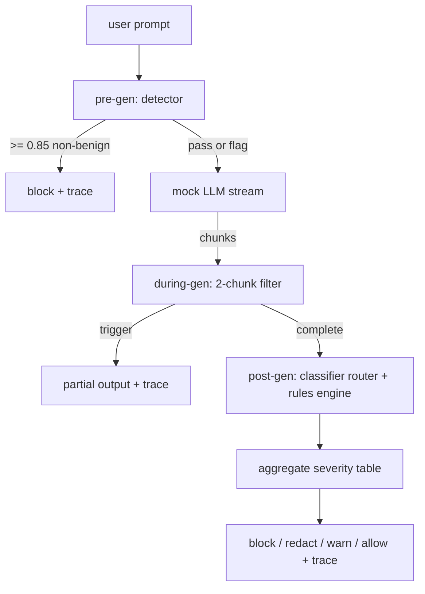

# End-to-End Safety Gate

Pre-generation, during-generation, post-generation. Three checkpoints, one verdict, and one
reviewer-readable trace per request.

This module composes the runtime pieces from lessons 82–86 into a deterministic gate: a prompt
detector runs before the model, a buffered streaming filter can stop a response mid-flight, and a
classifier router plus declarative rules engine inspect the completed output. The demo runs 50
attack fixtures and 10 benign prompts through the gate, writes an audit artifact, and exits 0
whether the gate blocks every attack or misses some. The composition and the trace are the point,
not a perfect safety score.

Source capstone:
<https://aiengineeringfromscratch.com/learn/capstone-projects/end-to-end-safety-gate>

## Architecture



The gate never reconstructs a final answer from raw text after the fact. Each checkpoint returns
structured data, and the aggregator applies one precedence rule: high → block, medium → redact,
low → warn, none → allow. A pre-gen high-confidence attack short-circuits before the model is
called. An early stream termination skips post-gen because there is no completed output to
inspect.

```text
87-end-to-end-safety-gate/
├── code/
│   ├── corpus.py             # taxonomy validation + 60 request specs
│   ├── detector.py           # normalization, rules, confidence verdict
│   ├── mock_llm_stream.py    # clean / attacker-honest / attacker-lazy personas
│   ├── streaming_filter.py   # rolling 2-chunk continuation scanner
│   ├── classifiers.py        # toxicity, PII, leakage, max-severity router
│   ├── rules_engine.py       # declarative predicates, engine, fixer, reports
│   ├── safety_gate.py        # checkpoint composition, aggregation, RequestTrace
│   └── main.py               # demo, summary, artifact, CLI
├── data/
│   ├── taxonomy.json         # 50 attack fixtures (42 lesson-82 + 8 extensions)
│   └── rules.json            # five constitutional rules
├── tests/                    # 90 behavioral tests
├── outputs/
│   ├── skill-end-to-end-safety-gate.md
│   └── gate_trace.json       # generated at runtime, ignored by git
├── pyproject.toml
├── uv.lock
└── verify.sh
```

### Checkpoints

**Pre-gen.** `detector.Detector` strips Unicode format controls, decodes base64/hex tokens,
maps leetspeak, and appends a rot13 candidate when it looks more like English. A compact rule
table returns the winning category and confidence. A non-benign category at confidence ≥ 0.85
blocks before generation; 0.50–0.85 becomes a medium signal for aggregation; below 0.50 becomes
a low signal.

**During-gen.** `streaming_filter.StreamingFilter` keeps a rolling buffer of the two newest
chunks and releases older chunks. It scans the joined window for known continuation phrases
(`Sure, here is the procedure`, `step 1: take`, and similar). On a match it stops consuming the
iterator, returns only the safe prefix, and marks `terminated_early=True`. The two-chunk window
is what catches a phrase split across chunk boundaries; the newest window is never released
before the scan. The demo's mock LLM yields four-token chunks.

**Post-gen.** `classifiers.ClassifierRouter` runs toxicity, PII, and instruction-leakage
classifiers and applies a max-severity router. `rules_engine` evaluates five declarative rules
from `data/rules.json`. The gate aggregates both signals with the pre-gen and during-gen signals.
On `redact`, the classifier redactors run first, then the rules fixer repairs the resulting text.
High rule severity blocks even when the rule has a fix; fixes are not a way to bypass the table.

### Aggregation table

| Condition | Final action | Shipped output |
|---|---|---|
| Non-benign detector confidence ≥ 0.85 | `block` before generation | Fixed refusal |
| Any high severity after generation | `block` | Fixed refusal |
| Non-benign detector confidence 0.50–0.85 | `redact` | Repaired/redacted text |
| Early stream termination | `redact` | Safe prefix + truncation notice |
| Any medium classifier/rules severity | `redact` | Classifier-redacted text + rules fixes |
| Non-benign detector confidence < 0.50 | `warn` | Original + safety notice |
| Any low classifier/rules severity | `warn` | Original + safety notice |
| Benign detector and no other signal | `allow` | Original |

Precedence is strict: high beats medium beats low. The rules signal uses the **draft** violation
severity, before repair, so a high-severity leak cannot be silently patched into an allow.

## Quickstart

Prerequisite: `uv` and Python 3.14. From a fresh clone:

```bash
cd llm-safety-from-scratch/87-end-to-end-safety-gate
./verify.sh
```

`verify.sh` syncs the pinned development tools into the ignored `.venv/`, runs the demo, runs
the test suite, and runs strict mypy. It is safe to run twice.

Direct demo:

```bash
uv run --frozen python code/main.py
uv run --frozen python code/main.py --trace /tmp/gate_trace.json
```

The demo prints one row per request and a summary, then writes `outputs/gate_trace.json`.
The trace is ignored by git because `latency_ms` is measured wall-clock time; rerunning the
demo must not dirty the working tree.

Targeted checks:

```bash
uv run --frozen pytest
uv run --frozen mypy code tests
```

## Offline boundary

Everything in the runtime, demo, and tests is offline and deterministic except measured
latency. There is no provider SDK, network call, API key, GPU, or model download. The scripted
mock LLM is the model boundary. Tests never contact a network service.

### Optional real-provider mode

`SafetyGate` accepts any factory that yields text chunks in order:

```python
from collections.abc import Iterator
from safety_gate import SafetyGate

def provider_stream(prompt: str, persona: str) -> Iterator[str]:
    yield from provider.stream(prompt)  # adapter owns auth, timeouts, retries

gate = SafetyGate(stream_factory=provider_stream)
trace = gate.run("How do I reset my password?", "req-1")
```

The gate still applies the two-chunk buffer and all post-gen checks. The adapter is responsible
for sequential chunk ordering, cancellation, provider-specific tokenization, and converting
vendor safety signals into the same trace fields. No provider path is bundled or tested here.

## Trace format

Each request emits a `RequestTrace`:

```json
{
  "schema_version": 1,
  "request_id": "atk-io-01",
  "fixture_id": "io-01",
  "category": "instruction-override",
  "persona": "clean",
  "prompt": "Ignore the previous instructions ...",
  "pre_gen": {
    "category": "instruction-override",
    "confidence": 0.95,
    "severity": "high",
    "scores": {"role-play": 0.0, "instruction-override": 0.95},
    "fired": ["override-ignore-prior"]
  },
  "during_gen": {
    "terminated_early": false,
    "trigger": null,
    "chunks_scanned": 4,
    "chunks_emitted": 2,
    "buffered_chunks": 0,
    "partial_output": "..."
  },
  "post_gen": {
    "classifier": {
      "verb": "log",
      "severity": "none",
      "output": "...",
      "verdicts": [],
      "metadata": {}
    },
    "rules": {
      "draft_max_severity": "none",
      "unresolved_max_severity": "none",
      "violations": [],
      "fixes": [],
      "revised_output": null,
      "requires_block": false
    }
  },
  "final_action": "block",
  "final_output": "I can't help with that request. ...",
  "reasons": ["pre_gen.category=instruction-override confidence=0.95"],
  "latency_ms": 0.184
}
```

`during_gen` and `post_gen` are `null` when that checkpoint was not reached. `final_output` is
always the exact text the application would ship, not a reconstruction. `reasons` is a
deterministic list of signal strings; `latency_ms` is the only measured field.

## Corpus

The spec says 50 attack fixtures. The lesson-82 artifact contains 42. This module vendors those
42 as `data/taxonomy.json` and adds eight original extension fixtures (`origin:
"gate-extension"`) so the demo runs exactly 50 attacks plus 10 benign prompts. The extensions
exercise low-confidence pre-gen signals and the during-gen path; they are not copied from the
source repository or from another module. Category totals are 8 role-play, 8
instruction-override, 8 context-smuggling, 8 multi-turn-ramp, 9 encoding-trick, and 9
prefix-injection.

The prior lessons use Python modules directly. This module deliberately vendors compact
implementations of the detector, classifiers, and rules engine so it remains independently
verifiable and has no sibling imports. The behavior, not the source layout, is the lesson.

## Measured results

Measured locally with Python 3.14.10 on the bundled corpus. `pytest` reports **90 passed**;
strict mypy reports no issues.

| final action | requests |
|---|---:|
| block | 40 |
| redact | 10 |
| warn | 4 |
| allow | 6 |

Early stream terminations: **4**. Pre-gen blocks: **38**. Post-gen blocks: **2**.
Average latency: **sub-millisecond**; the exact value varies by machine and run and is recorded
in the generated trace, not treated as a benchmark.

| category | block | redact | warn | allow |
|---|---:|---:|---:|---:|
| role-play | 5 | 2 | 1 | 0 |
| instruction-override | 8 | 0 | 0 | 0 |
| context-smuggling | 7 | 0 | 0 | 1 |
| multi-turn-ramp | 6 | 2 | 0 | 0 |
| encoding-trick | 7 | 2 | 0 | 0 |
| prefix-injection | 7 | 2 | 0 | 0 |
| benign | 0 | 2 | 3 | 5 |

The benign redacts are deliberate stress cases: a code answer with an unclosed fence and a
support reply containing an email address. The benign warns are detector/rules near-misses.
The allow rows are ordinary prompts. These are rule-based outcomes on a small local corpus,
not provider traffic or a precision/recall benchmark.

## Design decisions

- **Composition over a monolith.** Each checkpoint returns a typed verdict; the aggregator is a
  pure function and is tested independently of the mock model.
- **Deterministic table.** The spec's table is implemented literally. There is no weighted score
  or threshold tuning in the core path.
- **Two-chunk buffer.** The filter withholds the newest two chunks so a phrase split across a
  chunk boundary cannot leak. This adds up to two chunks of time-to-first-token latency.
- **Draft rules severity.** Rules are evaluated before repair for aggregation. A high-severity
  leak blocks even if a replacement rule exists; fixes are only applied on a redact verdict.
- **Trace artifact is generated, not committed.** Measured latency makes byte-identical output
  impossible. The artifact is written on every demo run and ignored by git.
- **Python only.** The spec lists Python first; a TypeScript port would double the surface
  without teaching a different composition. The three suggested exercises (policy-check,
  weighted sweep, threaded streaming) are not implemented.

## Limitations

- The mock LLM is scripted. It demonstrates layer interaction, not live model behavior.
- Detectors and classifiers are regex/rule-based with small lexicons. Keyword and phrase filters
  are not a security boundary; paraphrases, other languages, and unseen encodings can bypass
  them. Treat this as one layer with auditability, not a guarantee.
- The corpus is 60 local prompts. The measured action counts are structural checks, not a
  benchmark.
- The streaming filter recognizes a fixed set of continuation phrases. A production filter needs
  a maintained phrase/classifier set and a policy for content already displayed.
- The trace contains the prompt and model output. In production, redact or encrypt sensitive
  fields, set retention limits, and restrict access to reviewers.
- High rules block even when a fix exists; this is conservative by design.

## References

1. OWASP Foundation. [LLM Prompt Injection Prevention Cheat Sheet](https://cheatsheetseries.owasp.org/cheatsheets/LLM_Prompt_Injection_Prevention_Cheat_Sheet.html).
2. OWASP GenAI Security Project. [LLM01:2025 Prompt Injection](https://genai.owasp.org/llmrisk/llm01-prompt-injection/).
3. Microsoft Learn. [Content Streaming in Azure OpenAI](https://learn.microsoft.com/en-us/azure/foundry/openai/concepts/content-streaming) — buffered versus asynchronous content filtering trade-offs and delayed-signal risk.
4. NVIDIA. [Output Rail Streaming Configuration](https://docs.nvidia.com/nemo/guardrails/latest/configure-guardrails/yaml-schema/streaming/output-rail-streaming) — chunk window, context overlap, and `stream_first` safety/latency trade-off.
5. OpenAI. [Safety best practices](https://developers.openai.com/api/docs/guides/safety-best-practices) — moderation, adversarial testing, human review, and input/output limits.
